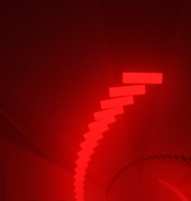
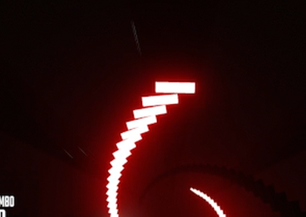
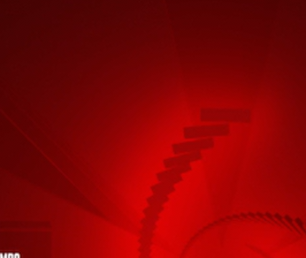
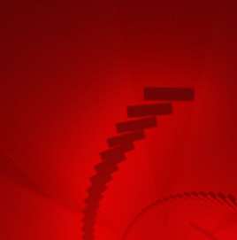

# Some notes on Colors

[Using ChromaGLS](UsingChromaGLS.md) | [Project overview](README.md)

For property names, JSON examples, transitions, and strobe controls, see [Using ChromaGLS](UsingChromaGLS.md#mapping). This guide focuses on how RGB, alpha, and brightness affect the rendered lights and fog.

## Behavior
Chroma Alpha and Brightness are effectively the same thing.
COLOR, however, is something different. Color effects fog bloom and the light itself differently. Colors can have values greater than 1.0, which can lead to interesting effects, but first lets cover the basics.

The brightness of an emissive surface (how rapidly it approaches white) is governed by:
```brightness * alpha.```

The color *below* the white level on that surface is produced by 
```color * brightness * alpha.```
where a result of 1.0+ in any color channel means fully saturated color. 

HOWEVER, once a lights brightess*alpha is high enough (somewhere between 50 and 100 light level usually), it replaces the color completely with white, **on the surface of the lights emissive material**. If you want to light up your light surfaces with a color instead of mostly white, then, it is important to keep your brightness * alpha < 0.5.

### Color, meanwhile, does its own thing
Color values can be greater than 1.0, which you can do by editing the json or simply editing the color numbers in the ChroMapper RGB picker to be > 1.0.
Color affects bloom in an exponential way. If you multiply your color by 2, and divide your (brightness * alpha) by 2, you will about double your fog bloom while keeping your emissive surface exactly the same color it already was. If you divide your (brightness * alpha) by 4 while multiplying color by 2, you will make your light surface darker while keeping bloom almost the same.

## How can we use this information?
### Lets take one of the cheat sheet examples below and derive it.
Here is 100 brightness, color 1,0,0 (default alpha = 1.0). So basically, your normal red 100 light:


Notice how it's surface is pretty whitened and kind of a washed out red.
### Lets say we want to have fully colored red light surface
(not white at all), but with a reasonable amount of bloom. This means:
- We should keep surface color (color \* (alpha\*brightness)) >= 1.0, or else the surface will be a darker color instead of saturated red.
- We need to keep white level of the surface down, aka keeping white level (alpha\*brightness) below 0.3-0.5 ish where lights start to whiten.
- We want to keep fog bloom down, so no high values for color * brightness \* alpha, since that squares into bloom.

So we might try something like `brightness = 0.2, color = 5,0,0` - producing:
- surface color `0.2 \* 5` = `1.0`
- surface whiteness `0.2 * 1.0` (the default alpha since we didn't specify) = `0.2`, which is not enough to produce surface whitening,
- fog bloom `0.2 * 5^2` = `25 * 0.2` = `5.0`, or about 5 times the normal 100 light level amount of fog bloom.


Sick. WAY more red now.

### Can we do better? 
Well, if our goal is to keep bloom as low as possible with the light level surface as high as possible, then yes, yes we can *(at least on this map, certain light materials may produce whiteness earlier or later - for some maps this could be the limit where the below starts to whiten your light already).*

If we reduce color further while keeping brightness below the point where it starts to turn white for this light:

We can try something like `Brightness = 0.5, color = 2,0,0` - producing:
- surface color `0.5 \* 2` = `1.0`
- surface whiteness `0.5 * 1.0` (the default alpha since we didn't specify) = `0.5`, which is not enough to produce surface whitening (for our light in question here).
- fog bloom `0.5 * 2^2` = `0.5 * 4` = `2.0`, or just double a normal 100 light level amount of fog bloom. And given bloom has a square falloff, it doesn't look THAT much different than the normal 100 light level red amount of bloom, if you compare the two.




* There is NO difference between brightness 100 and alpha 1.0, vs brightness 200 and alpha 0.5, nor brightness 50 and alpha 2.0. No matter what the other values of the light are, these will produce identical behavior both in bloom and surface color / whiteness of the light.

# Color goal cheat sheet 
Note that some lights turn white earlier than others. If you find these values produce whiter light surfaces than the image, try halving the brightness value from the examples below to see if that solves your light. 

### You want to:

- Have white light surfaces with dim thin color bloom:
    - Try something like `500 brightness, color [0.2,0,0]`

    

- Have white light surfaces with zero bloom:
    - Take the above inverse to its extreme, no color with alpha * brightness > 1.0: `brightness 500, color 0,0,0`.
    - Note that when using this effect you are able to control how dim the furthest lights in the fog are by cranking the brightness value up or down. 70 might be white up close and very faint far away while 500 will be white deep in the fog.

    

- A normal fog glow directly around the lights, but dark lights:
    - Try something like `brightness 0.01, color: [300,0,0,0.01]`
    - Note brightness * alpha * color is squared for the fog bloom, so changing one of the 0.01's to 0.1 will completely saturate the background with red - this is a fine line to walk.

    

- Have black light surfaces with tons of bloom around it:
    - Try something like `brightness 0.006, color [32,0,0]` 

    

- Have completely colored light surface (not white) AND fully saturate the bloom:
    - Try something like `brightness 0.01, color: [30000,0,0,0.01]`

    

- Have fully colored light surface (not white), reasonable amount of bloom:
    - Try something like `brightness = 0.2, color = 5,0,0`

    

- Have fully colored light surface (not white), low amount of bloom:
    - Try something like `brightness = 0.5, color = 2,0,0`

    

- Have dim lights blending in with the fog bloom around them:
    - Try something like just `0.4 brightness lights with 1.0 color channels`. If the light surfaces are brighter than the fog, drop brightness a little and increase color to compensate. If the light surfaces are dimmer than the fog, do the inverse.

    


# Color tweaking cheat sheet:
Even with the above, it isn't super obvious how to change just one aspect of your lights without affecting the others. This section goes over how to tweak one specific aspect of your light without affecting others.

## You want to:

- Increase the bloom color amount without changing the light surface color:
    - Multiply color by 2, divide either brightness or alpha by 2.
- Decrease bloom color amount while leaving light surface the same:
    - Divide color by 2, multiply brightness or alpha by 2.
